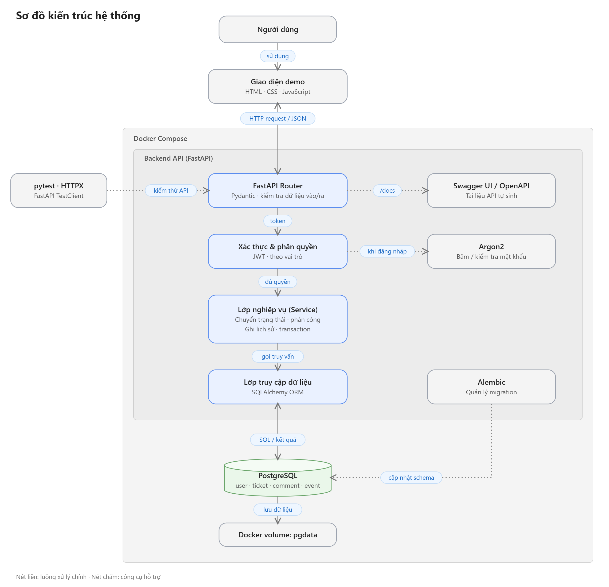
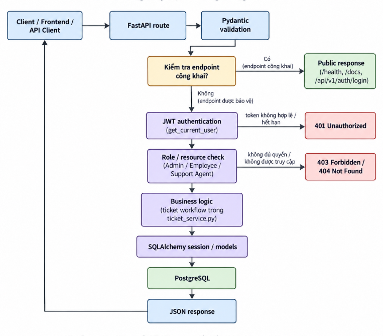
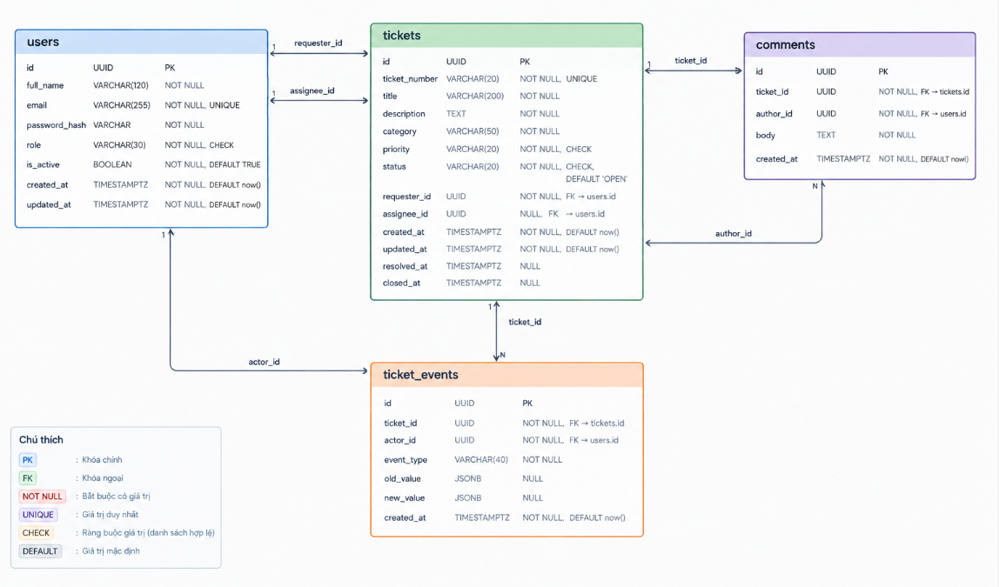
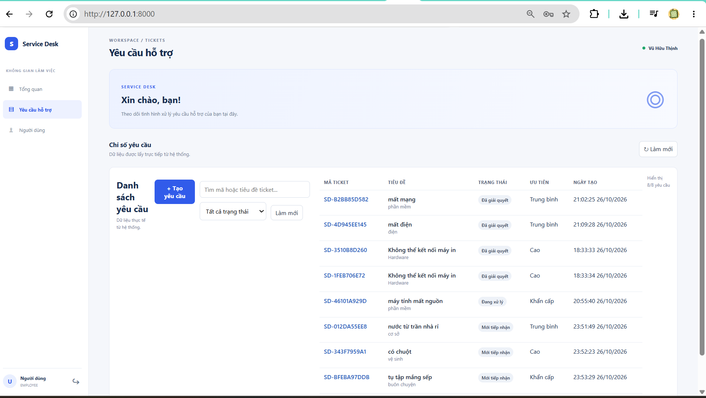
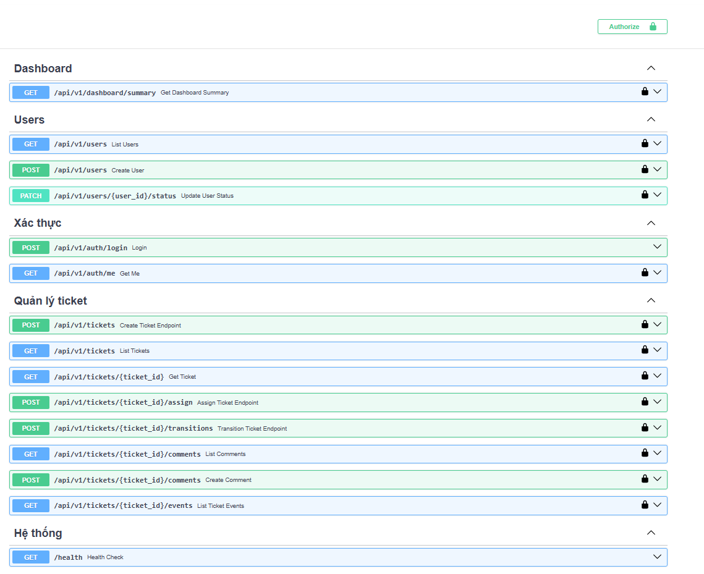
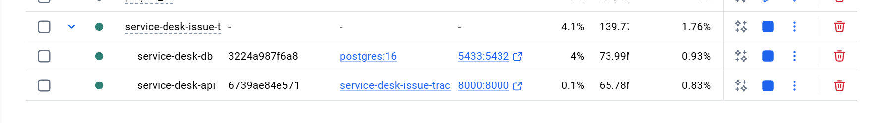
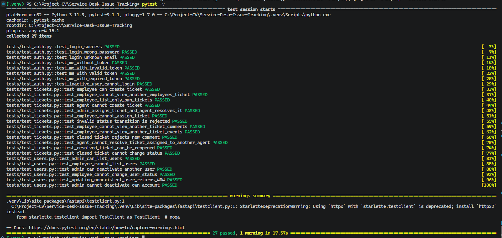

# Service Desk & Issue Tracking System

**Backend-focused portfolio project** · Python · FastAPI · PostgreSQL · Docker

Hệ thống quản lý yêu cầu hỗ trợ nội bộ (**service desk**), nơi nhân viên gửi ticket, quản trị viên phân công nhân viên hỗ trợ và người phụ trách cập nhật tiến độ xử lý. Dự án tập trung vào **REST API, xác thực JWT, phân quyền theo vai trò, quy tắc nghiệp vụ, thiết kế cơ sở dữ liệu và kiểm thử**; đi kèm giao diện web đơn giản để minh họa các thao tác.

> **Phạm vi triển khai:** Đây là một ứng dụng FastAPI theo kiến trúc *modular monolith*, không phải hệ thống microservices. Các chức năng mô tả dưới đây được đối chiếu với mã nguồn hiện tại. SLA, thông báo tự động và CI/CD chưa được triển khai.

## Mục lục

1. [Chức năng và vai trò](#1-chức-năng-và-vai-trò)
2. [Công nghệ](#2-công-nghệ)
3. [Kiến trúc và cách hệ thống hoạt động](#3-kiến-trúc-và-cách-hệ-thống-hoạt-động)
4. [Cấu trúc thư mục](#4-cấu-trúc-thư-mục)
5. [Cơ sở dữ liệu và vòng đời ticket](#5-cơ-sở-dữ-liệu-và-vòng-đời-ticket)
6. [Hướng dẫn chạy dự án](#6-hướng-dẫn-chạy-dự-án)
7. [API và hướng dẫn sử dụng](#7-api-và-hướng-dẫn-sử-dụng)
8. [Kiểm thử](#8-kiểm-thử)
9. [Hình ảnh minh chứng](#9-hình-ảnh-minh-chứng)
10. [Giới hạn và hướng phát triển](#10-giới-hạn-và-hướng-phát-triển)

## 1. Chức năng và vai trò

### Các chức năng đã có

- **Authentication:** đăng nhập bằng email và mật khẩu, cấp JWT access token; lấy thông tin người dùng từ token.
- **User Management:** Admin xem danh sách, tạo tài khoản và kích hoạt/vô hiệu hóa tài khoản.
- **Ticket Management:** tạo ticket, xem danh sách và chi tiết theo phạm vi quyền truy cập; lọc danh sách theo `status`, phân trang bằng `limit` và `offset`.
- **Assignment:** Admin phân công ticket cho Support Agent đang hoạt động.
- **Ticket Workflow:** Support Agent được phân công chuyển trạng thái ticket theo các quy tắc hợp lệ.
- **Comments & Audit Trail:** xem/thêm bình luận và đọc lịch sử sự kiện; không thêm bình luận vào ticket đã đóng.
- **Dashboard:** tổng hợp số ticket theo trạng thái và mức ưu tiên HIGH/URGENT, với dữ liệu được giới hạn theo vai trò.
- **Demo UI:** giao diện HTML/CSS/JavaScript phục vụ trực tiếp qua FastAPI.

### Phân quyền

| Vai trò | Phạm vi thao tác chính |
|---|---|
| `EMPLOYEE` | Tạo ticket; xem ticket do chính mình tạo; xem/thêm bình luận và lịch sử của ticket có quyền truy cập. |
| `SUPPORT_AGENT` | Xem ticket được giao; chuyển trạng thái ticket được giao; trao đổi và xem lịch sử trên ticket được phép truy cập. |
| `ADMIN` | Xem toàn bộ ticket; quản lý tài khoản; phân công ticket cho Support Agent; có thể tạo ticket. |

**Một số ràng buộc nghiệp vụ:** chỉ Admin phân công ticket; người nhận phải là Support Agent đang hoạt động; ticket `CLOSED` không được phân công lại hoặc bình luận thêm. Chỉ Support Agent được giao mới được chuyển trạng thái. Backend kiểm tra quyền cho từng endpoint, không chỉ dựa vào giao diện.

## 2. Công nghệ

| Thành phần | Công nghệ | Mục đích |
|---|---|---|
| Backend | Python 3.11, FastAPI, Uvicorn | Xây dựng và chạy REST API |
| Validation & settings | Pydantic, pydantic-settings | Kiểm tra request/response, đọc biến môi trường |
| Database | PostgreSQL 16 | Lưu dữ liệu nghiệp vụ |
| Data access | SQLAlchemy, psycopg | ORM, truy vấn và kết nối PostgreSQL |
| Migrations | Alembic | Quản lý phiên bản schema |
| Security | PyJWT, pwdlib/Argon2 | JWT và băm/xác minh mật khẩu |
| Testing | pytest, HTTPX, FastAPI TestClient | Kiểm thử API và quy tắc nghiệp vụ |
| Deployment | Docker, Docker Compose | Đóng gói API và chạy cùng PostgreSQL |
| Frontend | HTML, CSS, JavaScript | Giao diện demo |
| API documentation | OpenAPI, Swagger UI, ReDoc | Tra cứu và thử endpoint |

## 3. Kiến trúc và cách hệ thống hoạt động



*Hình 1 — Kiến trúc triển khai: Docker Compose điều phối hai dịch vụ `api` (FastAPI) và `db` (PostgreSQL); trình duyệt và công cụ kiểm thử gửi request đến API.*

Hệ thống theo kiểu **modular monolith**: một backend FastAPI chứa các module riêng, kết nối đến một cơ sở dữ liệu PostgreSQL. Các thành phần chính:

| Lớp / thành phần | Trách nhiệm trong kiến trúc hiện tại |
|---|---|
| **Client / Frontend** | Người dùng truy cập qua trình duyệt hoặc API client. Thư mục `frontend/` chứa HTML, CSS, JavaScript; FastAPI phục vụ giao diện tại `/` và nhận request HTTP/JSON. |
| **API Container — FastAPI** | Dockerfile đóng gói backend Python và frontend vào image API. `app/main.py` đăng ký router `auth`, `users`, `tickets`, `dashboard`; Uvicorn chạy ứng dụng trên cổng `8000`. |
| **Validation — Pydantic** | Các schema trong `app/schemas/` xác thực dữ liệu đầu vào và định dạng dữ liệu trả về; Pydantic không phải một dịch vụ/container riêng. |
| **Authentication & Security — JWT / Argon2** | `app/api/deps.py` dùng `get_current_user` để xác thực JWT và kiểm tra tài khoản; `app/core/security.py` xử lý tạo token và băm/xác minh mật khẩu bằng Argon2. Kiểm tra quyền vai trò/ticket được thực hiện trong các router và service. |
| **Business Logic — Ticket Service** | `app/services/ticket_service.py` triển khai quy tắc tạo/phân công ticket, kiểm tra quyền, chuyển trạng thái và ghi lịch sử sự kiện. Một số endpoint xử lý truy vấn SQLAlchemy ngay trong router. |
| **Data Access — SQLAlchemy** | `app/db/` cung cấp engine/session; `app/models/` ánh xạ bảng. SQLAlchemy thực hiện truy vấn và giao dịch với PostgreSQL, **không có lớp Repository riêng**. |
| **DB Container — PostgreSQL** | Docker Compose chạy PostgreSQL 16 trong service `db`, lưu bốn bảng nghiệp vụ `users`, `tickets`, `comments`, `ticket_events`; named volume `service_desk_data` giữ dữ liệu qua các lần tạo lại container thông thường. |
| **Schema Migration — Alembic** | `migrations/` và `alembic.ini` quản lý phiên bản schema. Theo cấu hình hiện có, migration chạy bằng **lệnh riêng từ máy host** sau khi PostgreSQL khởi động; Alembic **không phải container/service độc lập** và `docker compose up` không tự thực thi migration. |
| **Docker Compose & Testing** | `docker-compose.yml` điều phối **hai container `api` và `db`**, kết nối qua `db:5432` trong mạng Docker. `pytest` / `HTTPX` / `TestClient` là công cụ kiểm thử chạy ngoài hai service này, không phải thành phần vận hành liên tục. |

### Luồng xử lý request



*Hình 2 — Luồng tổng quát từ HTTP request đến phản hồi. Sơ đồ thể hiện đường đi điển hình; endpoint công khai và endpoint cần xác thực có nhánh xử lý khác nhau.*

1. **Client / Frontend** gửi HTTP request đến FastAPI router.
2. **Pydantic** kiểm tra dữ liệu đầu vào phù hợp với schema của endpoint.
3. Với **endpoint được bảo vệ**, dependency `get_current_user` xác thực JWT và trạng thái tài khoản; sau đó backend kiểm tra vai trò hoặc quyền truy cập ticket. Đăng nhập, health check và tài liệu API có luồng riêng.
4. Endpoint gọi **Ticket Service** khi cần quy tắc nghiệp vụ; những trường hợp khác có thể truy vấn **SQLAlchemy** trực tiếp.
5. SQLAlchemy đọc/ghi **PostgreSQL**, sau đó FastAPI trả response. Request không hợp lệ hoặc không đủ quyền sẽ nhận mã lỗi HTTP tương ứng.

> Lưu ý: sơ đồ minh họa luồng logic, không khẳng định tất cả endpoint đều lần lượt đi qua Ticket Service hoặc database. Tài liệu mô tả chi tiết hơn tại [docs/architecture.md](docs/architecture.md).

## 4. Cấu trúc thư mục

```text
.
├── app/                         # Mã nguồn backend FastAPI
│   ├── api/
│   │   ├── deps.py              # Dependency xác thực người dùng hiện tại
│   │   └── v1/
│   │       ├── auth.py          # API đăng nhập, thông tin tài khoản
│   │       ├── dashboard.py     # API thống kê ticket
│   │       ├── tickets.py       # API ticket, phân công, bình luận, sự kiện
│   │       └── users.py         # API quản lý người dùng
│   ├── core/                    # Cấu hình ứng dụng, JWT, băm mật khẩu
│   ├── db/                      # SQLAlchemy Base, engine và session
│   ├── models/                  # ORM models cho bốn bảng nghiệp vụ
│   ├── schemas/                 # Pydantic request/response schemas
│   ├── services/
│   │   └── ticket_service.py    # Quy tắc nghiệp vụ và lịch sử ticket
│   └── main.py                  # Khởi tạo FastAPI, router và frontend
├── docs/
│   ├── images/                  # Sơ đồ và ảnh minh chứng
│   ├── architecture.md          # Mô tả kiến trúc
│   ├── erd.md                   # Thiết kế CSDL, quan hệ, ràng buộc
│   └── requirements.md          # Yêu cầu nghiệp vụ
├── frontend/                    # Giao diện demo: HTML, CSS, JS
├── migrations/
│   └── versions/                # Các phiên bản migration Alembic
├── scripts/                     # Script tạo tài khoản demo
├── tests/                       # Fixture và test API
├── .env.example                 # Mẫu biến môi trường
├── alembic.ini                  # Cấu hình Alembic
├── Dockerfile                   # Image FastAPI
├── docker-compose.yml           # Dịch vụ API và PostgreSQL
├── requirements.txt             # Thư viện Python
└── README.md                    # Hướng dẫn sử dụng dự án
```

## 5. Cơ sở dữ liệu và vòng đời ticket

### ERD



*Hình 3 — Bốn bảng nghiệp vụ cùng các quan hệ khóa ngoại.*

| Bảng | Ý nghĩa |
|---|---|
| `users` | Danh tính, email, mật khẩu đã băm, vai trò và trạng thái tài khoản |
| `tickets` | Thông tin yêu cầu, mức ưu tiên, trạng thái, người tạo và người được giao |
| `comments` | Nội dung bình luận; tham chiếu ticket và người viết |
| `ticket_events` | Audit trail: người thao tác, loại sự kiện, giá trị trước/sau |

**Sáu khóa ngoại:** `tickets.requester_id`, `tickets.assignee_id`, `comments.author_id`, `comments.ticket_id`, `ticket_events.actor_id` và `ticket_events.ticket_id`. Hai cột `requester_id` và `assignee_id` cùng tham chiếu `users.id` nhưng khác ý nghĩa; `assignee_id` có thể để trống khi ticket chưa được giao.

Chi tiết kiểu cột, ràng buộc và chỉ mục: [docs/erd.md](docs/erd.md).

### Ticket workflow

```text
OPEN  ──>  IN_PROGRESS  ──>  RESOLVED  ──>  CLOSED
                 ^                  │
                 └──────────────────┘
```

- Ticket mới được tạo với trạng thái `OPEN`.
- Khi Admin phân công ticket đang `OPEN`, hệ thống chuyển sang `IN_PROGRESS`.
- Support Agent được giao có thể chuyển `IN_PROGRESS → RESOLVED`; ticket `RESOLVED` có thể được mở lại về `IN_PROGRESS` hoặc đóng thành `CLOSED`.
- `CLOSED` không có chuyển trạng thái tiếp theo trong logic hiện tại.
- Các thao tác tạo, phân công, đổi trạng thái và bình luận ghi sự kiện tương ứng: `TICKET_CREATED`, `TICKET_ASSIGNED`, `STATUS_CHANGED`, `COMMENT_ADDED`.

## 6. Hướng dẫn chạy dự án

Hướng dẫn dành cho **Windows PowerShell**. Có thể dùng terminal của VS Code tại thư mục gốc repository.

### 6.1. Yêu cầu môi trường

- Git để tải repository.
- Docker Desktop đang chạy (chế độ Linux containers), có Docker Compose.
- Python 3.11 để chạy **Alembic và seed từ máy host** (vì service `api` trong Dockerfile hiện chưa copy thư mục `scripts/`).

Kiểm tra nhanh:

```powershell
git --version
docker --version
docker compose version
python --version
```

### 6.2. Clone repository

```powershell
git clone https://github.com/VuHuuThinh05/service-desk-issue-tracking.git
cd service-desk-issue-tracking
```

### 6.3. Tạo cấu hình môi trường

```powershell
Copy-Item .env.example .env
notepad .env
```

Các biến quan trọng trong file mẫu:

| Biến | Vai trò | Giá trị mẫu |
|---|---|---|
| `POSTGRES_DB` | Tên database | `service_desk` |
| `POSTGRES_USER` | Tài khoản PostgreSQL | `service_desk_user` |
| `POSTGRES_PASSWORD` | Mật khẩu PostgreSQL | Thay giá trị mẫu |
| `POSTGRES_HOST_PORT` | Cổng PostgreSQL mở trên máy host | `5433` |
| `DB_HOST` | Host để lệnh Python chạy **trên máy** kết nối DB | `localhost` |
| `DB_PORT` | Cổng cho lệnh Python chạy **trên máy** | `5433` |
| `JWT_SECRET_KEY` | Khóa ký JWT | Thay bằng chuỗi bí mật đủ mạnh |
| `JWT_ALGORITHM` | Thuật toán JWT | `HS256` |
| `JWT_EXPIRE_MINUTES` | Thời hạn access token (phút) | `30` |

**Quan trọng:** không commit `.env` lên GitHub. Khi chạy trong container, Docker Compose tự đặt `DB_HOST=db`, `DB_PORT=5432`; trong PowerShell host, giữ `localhost:5433` theo file mẫu. Nếu đổi `POSTGRES_HOST_PORT`, cập nhật `DB_PORT` tương ứng cho lệnh chạy ở host.

### 6.4. Khởi động PostgreSQL và API

```powershell
docker compose up --build -d
docker compose ps
```

Theo `docker-compose.yml`, hai service được tạo:

- **`db`** (`service-desk-db`): PostgreSQL 16, healthcheck và volume `service_desk_data`.
- **`api`** (`service-desk-api`): Uvicorn/FastAPI tại cổng `8000`; khởi động sau khi database healthy.

Kiểm tra log:

```powershell
docker compose logs --tail 100 db
docker compose logs --tail 100 api
```

> API có thể khởi động thành công trong khi các bảng nghiệp vụ chưa tồn tại. **Cần thực hiện bước migration tiếp theo** trước khi đăng nhập và thao tác dữ liệu.

### 6.5. Tạo môi trường Python và chạy migration

Trong **PowerShell tại thư mục gốc**:

```powershell
python -m venv .venv
.\.venv\Scripts\python.exe -m pip install -r requirements.txt
.\.venv\Scripts\python.exe -m alembic upgrade head
```

Alembic đọc cấu hình từ `.env` của máy host qua `app/core/config.py`, sử dụng `DB_HOST=localhost` và `DB_PORT=5433` (hoặc cổng host bạn thiết lập).

Kiểm tra phiên bản migration:

```powershell
.\.venv\Scripts\python.exe -m alembic current
```

Chạy migration chỉ với database phát triển đã được xác nhận đúng. Không chạy `docker compose down -v` nếu muốn giữ dữ liệu PostgreSQL.

### 6.6. Tạo tài khoản demo

Sau khi migration thành công, chạy script seed từ **máy host**:

```powershell
.\.venv\Scripts\python.exe -m scripts.seed_users
```

Script yêu cầu nhập và xác nhận **mật khẩu demo dùng chung** (ít nhất 12 ký tự). Mật khẩu không hiển thị khi nhập và không được in ra terminal. Các tài khoản sau được tạo nếu chưa tồn tại:

| Email demo | Role |
|---|---|
| `admin@servicedesk.local` | ADMIN |
| `agent1@servicedesk.local` | SUPPORT_AGENT |
| `agent2@servicedesk.local` | SUPPORT_AGENT |
| `employee1@servicedesk.local` | EMPLOYEE |
| `employee2@servicedesk.local` | EMPLOYEE |
| `employee3@servicedesk.local` | EMPLOYEE |

Script bỏ qua email đã tồn tại. Các email `.local` chỉ phục vụ demo và không phải hộp thư thực.

### 6.7. Truy cập và kiểm tra

| Địa chỉ | Mục đích |
|---|---|
| http://localhost:8000/ | Giao diện demo |
| http://localhost:8000/docs | Swagger UI, thử API |
| http://localhost:8000/redoc | Tài liệu ReDoc |
| http://localhost:8000/health | Health check |

Kiểm tra health từ PowerShell:

```powershell
Invoke-RestMethod http://localhost:8000/health
```

Kết quả kỳ vọng: `{"status":"ok"}`. Đây chỉ là kiểm tra ứng dụng phản hồi, **không** thay thế thử thao tác database.

**Quy trình demo đề xuất:** đăng nhập với Admin → tạo/xem tài khoản → đăng nhập Employee và tạo ticket → đăng nhập Admin phân công Support Agent → đăng nhập Agent chuyển trạng thái/thêm bình luận → xem lịch sử sự kiện và dashboard.

### 6.8. Dừng, chạy lại và xử lý lỗi cơ bản

```powershell
docker compose stop              # Dừng tạm, giữ container
docker compose start             # Khởi động lại
docker compose down              # Xóa container/network, giữ named volume
docker compose up --build -d     # Khởi động lại và build API
```

| Tình huống | Kiểm tra |
|---|---|
| Docker không khởi động | Mở Docker Desktop; chạy `docker compose ps`. |
| Cổng `8000` hoặc `5433` đang được sử dụng | Kiểm tra ứng dụng đang chiếm cổng; đổi cổng host PostgreSQL trong `.env` nếu cần. |
| API trả lỗi thiếu bảng | Chạy `alembic upgrade head` ở bước 6.5. |
| Host không kết nối PostgreSQL | Kiểm tra `DB_HOST=localhost`, `DB_PORT=POSTGRES_HOST_PORT` và `docker compose logs db`. |
| Đăng nhập thất bại | Xác nhận đã seed, dùng đúng email/mật khẩu và tài khoản còn hoạt động. |
| Token không hợp lệ | Kiểm tra `JWT_SECRET_KEY` và đăng nhập lại để lấy token mới. |

## 7. API và hướng dẫn sử dụng

Các endpoint nghiệp vụ sử dụng prefix **`/api/v1`**. Endpoint cần xác thực nhận JWT dưới dạng `Authorization: Bearer <access_token>`.

| Method | Endpoint | Chức năng |
|---|---|---|
| POST | `/api/v1/auth/login` | Đăng nhập, trả access token |
| GET | `/api/v1/auth/me` | Thông tin tài khoản từ token |
| GET | `/api/v1/users` | Danh sách tài khoản (Admin) |
| POST | `/api/v1/users` | Tạo tài khoản (Admin) |
| PATCH | `/api/v1/users/{user_id}/status` | Kích hoạt/vô hiệu hóa tài khoản (Admin) |
| POST | `/api/v1/tickets` | Tạo ticket |
| GET | `/api/v1/tickets` | Danh sách ticket theo quyền |
| GET | `/api/v1/tickets/{ticket_id}` | Chi tiết ticket |
| POST | `/api/v1/tickets/{ticket_id}/assign` | Phân công ticket (Admin) |
| POST | `/api/v1/tickets/{ticket_id}/transitions` | Chuyển trạng thái (Agent được giao) |
| GET | `/api/v1/tickets/{ticket_id}/comments` | Danh sách bình luận |
| POST | `/api/v1/tickets/{ticket_id}/comments` | Thêm bình luận |
| GET | `/api/v1/tickets/{ticket_id}/events` | Xem audit trail |
| GET | `/api/v1/dashboard/summary` | Thống kê tổng hợp |

**Ví dụ lọc ticket:** `GET /api/v1/tickets?status=OPEN&limit=20&offset=0`. Danh sách hiện **chưa có** query filter riêng theo `priority` hoặc `assignee_id`.

Để xem request body, schema response và status code chính xác của từng endpoint, mở [Swagger UI](http://localhost:8000/docs) khi API đang chạy.

## 8. Kiểm thử

Dự án có test cho xác thực, phân quyền, quản lý người dùng và thao tác ticket. Fixture trong `tests/conftest.py` sử dụng **SQLite in-memory riêng cho từng test**, đồng thời override dependency `get_db` của FastAPI.

Chạy từ thư mục gốc:

```powershell
.\.venv\Scripts\python.exe -m pytest -v
```

Hoặc kiểm tra riêng nhóm test:

```powershell
.\.venv\Scripts\python.exe -m pytest tests/test_auth.py -v
.\.venv\Scripts\python.exe -m pytest tests/test_users.py -v
.\.venv\Scripts\python.exe -m pytest tests/test_tickets.py -v
```

**Phạm vi xác nhận:** đây là các test backend dùng SQLite; chưa nên mô tả kết quả này như một lần kiểm thử tích hợp PostgreSQL. Số test pass cụ thể phụ thuộc kết quả chạy thực tế; xem ảnh minh chứng bên dưới.

## 9. Hình ảnh minh chứng

Các ảnh được lưu trong `docs/images/` nhằm giúp người xem repository nhanh chóng hình dung kết quả chạy hệ thống.

### 9.1. Ticket Interface



*Hình 4 — Giao diện demo: minh họa cách người dùng tương tác với các chức năng ticket thông qua frontend HTML/CSS/JavaScript. Quyền thực hiện thao tác vẫn được kiểm tra ở backend.*

### 9.2. API Documentation — Swagger UI



*Hình 5 — Swagger UI được FastAPI sinh từ OpenAPI schema, thể hiện nhóm endpoint, phương thức HTTP và cho phép thử request/response khi backend đang chạy.*

### 9.3. Docker Services



*Hình 6 — Trạng thái các container FastAPI và PostgreSQL khi triển khai bằng Docker Compose. PostgreSQL sử dụng named volume để lưu dữ liệu.*

### 9.4. Test Results



*Hình 7 — Kết quả chạy pytest. Khi cập nhật code hoặc test, cần chụp lại kết quả tương ứng; ảnh chỉ phản ánh lần chạy tại thời điểm chụp.*

## 10. Giới hạn và hướng phát triển

Dự án hiện ưu tiên các nghiệp vụ backend cốt lõi. Một số hướng mở rộng **chưa triển khai**:

- Bộ lọc ticket nâng cao theo priority, assignee và khoảng thời gian.
- SLA, deadline, cảnh báo quá hạn và notification.
- Dashboard với thời gian xử lý trung bình hoặc KPI nâng cao.
- Integration tests trên PostgreSQL và CI tự động chạy test.
- Quản lý secrets, logging, triển khai production và nâng cấp UI.

### Tài liệu bổ sung

- [Architecture](docs/architecture.md)
- [Database Design / ERD](docs/erd.md)
- [Business Requirements](docs/requirements.md)

---

